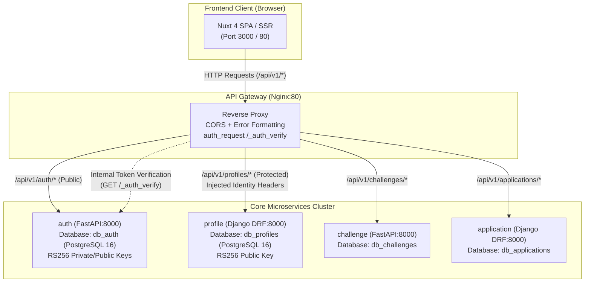
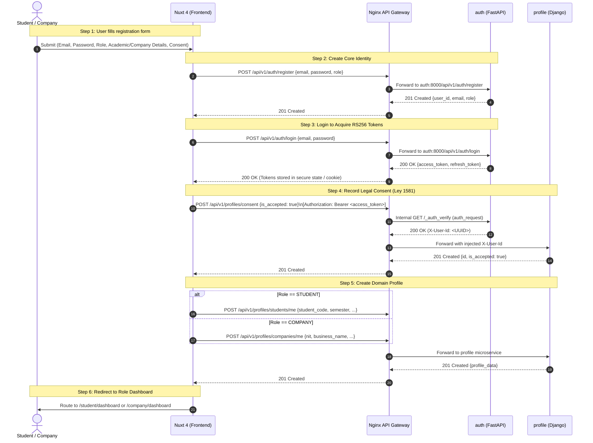

# Conecta Nexus — Frontend API Contract, Gateway Architecture & Authentication Flow

> **Version:** 1.1.0  
> **Target Audience:** Frontend Engineering Team (Nuxt 4 / Vue 3)  
> **Status:** Fully Specified & Implemented on Remote `develop` (Auth, Gateway & Profile Live)  
> **Repositories Involved:** `frontend`, `gateway`, `auth`, `profile`

---

## 1. Executive Architecture Overview

Conecta Nexus operates as a decoupled microservices ecosystem. The frontend client application (built with **Nuxt 4**, **Vue 3**, **Tailwind CSS**, and **TypeScript**) **never communicates directly with individual microservice backend ports**. All HTTP and WebSocket communications are routed through a central **Nginx API Gateway**.



### 1.1. Local Development Topology (Podman / Docker Compose)
In the local development environment orchestrated via `compose.yaml`:
* **Gateway Container:** Exposed on host port `80` (or `8080`), acting as the unified entry point.
* **Frontend Container:** Runs Nuxt development server on internal port `3000` (mapped to `80` at the gateway root `/`).
* **Auth Container:** Internal DNS name `auth:8000`.
* **Profile Container:** Internal DNS name `profile:8000`.
* **Database Container:** `postgres:5432` hosting independent logical databases (`db_auth`, `db_profiles`, `db_challenges`, `db_applications`).

> [!TIP]
> In local development, the frontend client should configure its base API URL as `/api/v1` (relative path) or `http://localhost/api/v1`. Because the Nginx gateway serves the frontend assets and routes `/api/v1/*`, relative requests prevent all browser cross-origin complications.

### 1.2. Cloud Production Topology (Google Cloud Platform)
In cloud production:
* **Edge & TLS:** Cloud Load Balancing (or Cloud Run Ingress) terminates TLS on `443` for `conectanexus.ufps.edu.co` and `api.conectanexus.ufps.edu.co`.
* **Microservices:** Deployed on Google Cloud Run or GKE inside a private VPC.
* **Security & Secrets:** RS256 RSA 2048-bit Private Key is securely injected via GCP Secret Manager into the `auth` service. Downstream services (`gateway`, `profile`) retrieve the Public Key via internal endpoint `GET /api/v1/auth/certs` or mounted environment variable `JWT_PUBLIC_KEY`.
* **Database:** Cloud SQL for PostgreSQL 16 with instance-level isolation per microservice.

---

## 2. API Gateway & Routing Architecture

The Nginx Gateway (`gateway/conf.d/default.conf`) is configured as a reverse proxy with two routing modes:

### 2.1. Route Categorization
| Route Pattern | Target Upstream | Auth Policy | Description |
| :--- | :--- | :--- | :--- |
| `/api/v1/auth/*` | `http://auth:8000` | **Public** | Account registration, OAuth2 login, token refresh, public key certs. |
| `/api/v1/profiles/*` | `http://profile:8000` | **Protected** (`auth_request`) | Student profiles, company profiles, Habeas Data consent. |
| `/api/v1/challenges/*` | `http://challenge:8000` | **Protected** (`auth_request`) | Problematic challenges, attachment uploads, state transitions. |
| `/api/v1/applications/*`| `http://application:8000` | **Protected** (`auth_request`) | Student project applications, acceptance/rejection workflows. |
| `/gateway/health` | Local Gateway | **Public** | Nginx heartbeat check (`{"status":"healthy"}`). |
| `/` | `http://frontend:3000` | **Public** | Nuxt 4 web app, assets, and WebSocket Vite HMR. |

### 2.2. The `auth_request` Subrequest Mechanism
For any protected route (such as `/api/v1/profiles/*`), Nginx validates the client's Bearer token **before forwarding the request to the target microservice**:

1. **Subrequest:** Nginx issues an internal HTTP `GET` request to `/_auth_verify` (`http://auth:8000/api/v1/auth/verify`), forwarding the incoming `Authorization: Bearer <token>` header without copying request body.
2. **Cryptographic Check:** `auth` decodes the RS256 JWT using its RSA public key, checks expiration, status, and scopes in sub-50ms latency.
3. **Identity Header Injection:** If valid (HTTP 200), `auth` returns identity headers. Nginx captures these via `auth_request_set` and injects them as trusted upstream headers:
   * `X-User-Id`: UUID string of the authenticated user (JWT claim `sub`).
   * `X-User-Email`: Email string of the authenticated user.
   * `X-User-Role`: Operational role (`STUDENT`, `COMPANY`, or `ADMIN`).
   * `X-User-Scopes`: Space-delimited string of OAuth2 scopes granted.
4. **Rejection:** If the token is missing, expired, or invalid, Nginx immediately short-circuits the connection and returns HTTP 401 with standard JSON error formatting. The downstream service (`profile`) is never touched.

### 2.3. Gateway Error Response Contracts
When a gateway-level error occurs, the response body always follows this schema:

```json
{
  "detail": "Unauthorized: Missing, invalid, or expired Bearer access token"
}
```

* **HTTP 401 Unauthorized:** Missing, malformed, or expired access token.
* **HTTP 403 Forbidden:** Access denied or account suspended.
* **HTTP 502 Bad Gateway:** The target microservice container is offline or restarting.
* **HTTP 504 Gateway Timeout:** Upstream microservice took longer than 90 seconds.

---

## 3. Authentication & Authorization Protocol (RS256 JWT)

### 3.1. Asymmetric Cryptography Specifications (ADR-002)
* **Algorithm:** `RS256` (RSA Signature with SHA-256, 2048-bit key).
* **Issuer (`iss`):** `https://auth.conectanexus.ufps.edu.co`
* **Audience (`aud`):** `conecta-nexus-services`

### 3.2. Token Lifecycle
* **Access Token (`access_token`):**
  * **Lifetime:** **15 minutes** (`900` seconds).
  * **Transmission:** Passed by the frontend in the HTTP `Authorization` header: `Authorization: Bearer <access_token>`.
  * **Payload Claims:**
    ```json
    {
      "sub": "550e8400-e29b-41d4-a716-446655440000",
      "email": "juan.perez@ufps.edu.co",
      "role": "STUDENT",
      "scope": "consent:write consent:read profile:student:read profile:student:write profile:company:read_public challenge:read application:create application:read_own",
      "type": "access",
      "is_active": true,
      "iss": "https://auth.conectanexus.ufps.edu.co",
      "aud": "conecta-nexus-services",
      "iat": 1792500000,
      "exp": 1792500900
    }
    ```
* **Refresh Token (`refresh_token`):**
  * **Lifetime:** **7 days** (`604800` seconds).
  * **Transmission:** Passed only to `POST /api/v1/auth/refresh` or `POST /api/v1/auth/logout`.
  * **Single-Use Rotation:** Every time `/api/v1/auth/refresh` is called, the old refresh token is **revoked** and a brand new token pair (`access_token` + `refresh_token`) is returned.

### 3.3. Complete Role & OAuth2 Scope Matrix (Aligned with `auth/src/core/security.py`)

| Role | Permitted Email Domains | Exact OAuth2 Scopes (`scope` claim) | Target Landing View |
| :--- | :--- | :--- | :--- |
| **`STUDENT`** | Strictly `@ufps.edu.co` | `consent:write`<br>`consent:read`<br>`profile:student:read`<br>`profile:student:write`<br>`profile:company:read_public`<br>`challenge:read`<br>`application:create`<br>`application:read_own` | `/student/dashboard` |
| **`COMPANY`** | Commercial / Corporate domains | `consent:write`<br>`consent:read`<br>`profile:company:read`<br>`profile:company:write`<br>`profile:student:read_public`<br>`challenge:create`<br>`challenge:read_own`<br>`challenge:write_own`<br>`application:read_received`<br>`application:decide` | `/company/dashboard` |
| **`ADMIN`** | Internal institutional accounts | `profile:read_all`<br>`challenge:read_all`<br>`challenge:moderate`<br>`user:status:write`<br>`audit:read` | `/admin/dashboard` |

---

## 4. API Endpoints Specification & Contracts

### 4.1. Master Endpoints Summary Table

| Service | Method | Route | Auth Required | Required Scopes / Roles | Description | Implementation Status |
| :--- | :---: | :--- | :---: | :--- | :--- | :---: |
| **`auth`** | `POST` | `/api/v1/auth/register` | No | None | Create student or company credentials | **Ready** |
| **`auth`** | `POST` | `/api/v1/auth/login` | No | None | Authenticate credentials, issue token pair | **Ready** |
| **`auth`** | `POST` | `/api/v1/auth/refresh` | No | Refresh Token | Rotate refresh token, get new pair | **Ready** |
| **`auth`** | `POST` | `/api/v1/auth/logout` | Optional | Refresh Token | Revoke active user session | **Ready** |
| **`auth`** | `GET` | `/api/v1/auth/verify` | Yes | Bearer Token | Stateless JWT inspection | **Ready** |
| **`auth`** | `GET` | `/api/v1/auth/certs` | No | None | Retrieve RSA public key in PEM format | **Ready** |
| **`profile`** | `POST` | `/api/v1/profiles/consent` | Yes | `consent:write` | Register Habeas Data (Law 1581) consent | **Ready** |
| **`profile`** | `GET` | `/api/v1/profiles/consent/me` | Yes | `consent:read` | Inspect user's Habeas Data consent status | **Ready** |
| **`profile`** | `POST` | `/api/v1/profiles/students/me` | Yes | `STUDENT`, `profile:student:write` + Consent | Create initial academic student profile | **Ready** |
| **`profile`** | `GET` | `/api/v1/profiles/students/me` | Yes | `STUDENT`, `profile:student:read` | Retrieve full private student profile | **Ready** |
| **`profile`** | `PATCH` | `/api/v1/profiles/students/me` | Yes | `STUDENT`, `profile:student:write` + Consent | Partial update of mutable academic fields | **Ready** |
| **`profile`** | `GET` | `/api/v1/profiles/students/{user_id}/public` | Yes | `COMPANY`, `profile:student:read_public` | Public student profile (contact masked) | **Ready** |
| **`profile`** | `POST` | `/api/v1/profiles/companies/me` | Yes | `COMPANY`, `profile:company:write` + Consent | Register corporate partner profile | **Ready** |
| **`profile`** | `GET` | `/api/v1/profiles/companies/me` | Yes | `COMPANY`, `profile:company:read` | Retrieve full private company profile | **Ready** |
| **`profile`** | `PATCH` | `/api/v1/profiles/companies/me` | Yes | `COMPANY`, `profile:company:write` + Consent | Update corporate profile (NIT immutable) | **Ready** |
| **`profile`** | `GET` | `/api/v1/profiles/companies/{user_id}/public` | Yes | `STUDENT`, `profile:company:read_public` | Public company profile (contact masked) | **Ready** |
| **`profile`** | `GET` | `/api/v1/profiles/internal/{user_id}/eligibility` | Yes | Internal Service / Admin | Inter-service student eligibility & contact | **Ready** |

---

### 4.2. Detailed Contract: Auth Microservice (`auth`)

#### 4.2.1. `POST /api/v1/auth/register`
Creates the central identity credential in `db_auth`.

* **Headers:** `Content-Type: application/json`
* **Request Body:**
  ```json
  {
    "email": "juan.perez@ufps.edu.co",
    "password": "Password123!",
    "role": "STUDENT"
  }
  ```
  *Validation Rules:*
  * `email`: Valid email. Must end with `@ufps.edu.co` if `role == "STUDENT"`.
  * `password`: Minimum 8 chars, at least 1 uppercase, 1 lowercase, 1 number, 1 special character.
  * `role`: Either `"STUDENT"` or `"COMPANY"`. (`"ADMIN"` cannot be registered publicly).
* **Success Response (`201 Created`):**
  ```json
  {
    "id": "c7a8b291-7649-4f76-80f4-5f537d995960",
    "email": "juan.perez@ufps.edu.co",
    "role": "STUDENT",
    "is_active": true,
    "is_email_verified": false,
    "created_at": "2026-10-20T20:30:00Z"
  }
  ```
* **Error Responses:**
  * `409 Conflict`: `{"detail": "Email is already registered"}`
  * `422 Unprocessable Entity`: Input failed Pydantic validation (e.g. invalid domain or weak password).

---

#### 4.2.2. `POST /api/v1/auth/login`
Authenticates user credentials and issues RS256 token pair.

* **Headers:** `Content-Type: application/json`
* **Request Body:**
  ```json
  {
    "email": "juan.perez@ufps.edu.co",
    "password": "Password123!"
  }
  ```
* **Success Response (`200 OK`):**
  ```json
  {
    "access_token": "eyJhbGciOiJSUzI1NiIsInR5cCI6IkpXVCIsImtpZCI6...",
    "refresh_token": "eyJhbGciOiJSUzI1NiIsInR5cCI6IkpXVCIsImtpZCI6...",
    "token_type": "bearer",
    "expires_in": 900
  }
  ```
* **Error Responses:**
  * `401 Unauthorized`: `{"detail": "Invalid email or password"}`
  * `403 Forbidden`: `{"detail": "Account is inactive or suspended"}`

---

#### 4.2.3. `POST /api/v1/auth/refresh`
Rotates a refresh token to obtain a fresh access token without asking for user re-login.

* **Headers:** `Content-Type: application/json`
* **Request Body:**
  ```json
  {
    "refresh_token": "eyJhbGciOiJSUzI1NiIsInR5cCI6IkpXVCIs..."
  }
  ```
* **Success Response (`200 OK`):**
  ```json
  {
    "access_token": "eyJhbGciOiJSUzI1NiIsInR5cCI6IkpXVCIs...",
    "refresh_token": "eyJhbGciOiJSUzI1NiIsInR5cCI6IkpXVCIs...",
    "token_type": "bearer",
    "expires_in": 900
  }
  ```
* **Error Responses:**
  * `401 Unauthorized`: `{"detail": "Invalid or expired refresh token"}`
  * `403 Forbidden`: `{"detail": "Account is inactive or suspended"}`

---

#### 4.2.4. `POST /api/v1/auth/logout`
Revokes active user session and blacklists the refresh token in `db_auth`.

* **Headers:** `Content-Type: application/json`
* **Request Body:**
  ```json
  {
    "refresh_token": "eyJhbGciOiJSUzI1NiIsInR5cCI6IkpXVCIs..."
  }
  ```
* **Success Response (`200 OK`):**
  ```json
  {
    "message": "Successfully logged out"
  }
  ```

---

#### 4.2.5. `GET /api/v1/auth/verify`
High-performance session verification endpoint (SLA < 50ms).

* **Headers:** `Authorization: Bearer <access_token>`
* **Success Response (`200 OK`):**
  ```json
  {
    "valid": true,
    "user_id": "c7a8b291-7649-4f76-80f4-5f537d995960",
    "email": "juan.perez@ufps.edu.co",
    "role": "STUDENT",
    "scopes": [
      "consent:write",
      "consent:read",
      "profile:student:read",
      "profile:student:write",
      "profile:company:read_public",
      "challenge:read",
      "application:create",
      "application:read_own"
    ]
  }
  ```

---

### 4.3. Detailed Contract: Profile Microservice (`profile`)

#### 4.3.0. Standard Profile Error Envelope Structure
All errors returned by the `profile` microservice follow a unified envelope configured via `apps.core.exceptions.api_exception_handler`:

```json
{
  "error": {
    "status": 400,
    "code": "validation_error",
    "message": "Request validation failed.",
    "details": {
      "field_name": [
        "Descriptive validation error message."
      ]
    }
  }
}
```

Standard Error Codes:
* `validation_error` (HTTP 400): Request payload failed serializer validation.
* `permission_denied` (HTTP 403): Missing required role, scope, or missing Habeas Data consent.
* `not_found` (HTTP 404): Resource not found for the user or id.
* `internal_server_error` (HTTP 500): Unhandled exception in service.

---

#### 4.3.1. Habeas Data Consent (`apps/consents/`)

##### `POST /api/v1/profiles/consent` (also accepts `/consents/` and `/consent/`)
Registers explicit user acceptance of personal data processing under Colombian Statutory Law 1581 of 2012.

* **Headers:**
  * `Authorization: Bearer <access_token>`
  * `Content-Type: application/json`
* **Request Body:**
  ```json
  {
    "is_accepted": true,
    "policy_version": "v1.0-2026"
  }
  ```
* **Success Response (`201 Created`):**
  ```json
  {
    "id": "e305e04c-3522-4ffc-a335-e115e5a7ce9e",
    "user_id": "c7a8b291-7649-4f76-80f4-5f537d995960",
    "policy_version": "v1.0-2026",
    "is_accepted": true,
    "accepted_at": "2026-10-20T20:35:12.183492Z"
  }
  ```
* **Error Responses:**
  * `400 Bad Request`:
    ```json
    {
      "error": {
        "status": 400,
        "code": "validation_error",
        "message": "Request validation failed.",
        "details": {
          "is_accepted": ["Consent must be explicitly accepted (is_accepted must be true)."]
        }
      }
    }
    ```
  * `401 Unauthorized`: Token missing or expired.
  * `403 Forbidden`: Token lacks `consent:write` scope.

##### `GET /api/v1/profiles/consent/me`
Checks if the authenticated user has active consent registered.

* **Headers:** `Authorization: Bearer <access_token>`
* **Success Response (`200 OK`):**
  ```json
  {
    "id": "e305e04c-3522-4ffc-a335-e115e5a7ce9e",
    "user_id": "c7a8b291-7649-4f76-80f4-5f537d995960",
    "policy_version": "v1.0-2026",
    "is_accepted": true,
    "accepted_at": "2026-10-20T20:35:12.183492Z"
  }
  ```
* **Error Responses:**
  * `404 Not Found`:
    ```json
    {
      "error": {
        "status": 404,
        "code": "not_found",
        "message": "No consent record found for the authenticated user.",
        "details": {
          "detail": "No consent record found for the authenticated user."
        }
      }
    }
    ```

---

#### 4.3.2. Student Profiles (`apps/students/`)

##### `POST /api/v1/profiles/students/me`
Creates the academic profile for an authenticated student.

* **Headers:**
  * `Authorization: Bearer <access_token>`
  * `Content-Type: application/json`
* **Authorization & Scopes:**
  * Requires role: `STUDENT`
  * Requires scope: `profile:student:write`
  * Requires prior consent: `HasAcceptedConsent` (User must have accepted Law 1581 consent first, otherwise returns `403 Forbidden`).
* **Request Body:**
  ```json
  {
    "full_name": "Juan Pérez Rodríguez",
    "student_code": "1152375",
    "academic_program": "Ingeniería de Sistemas",
    "current_semester": 7,
    "completed_courses": [
      "Bases de Datos",
      "Ingeniería de Software I",
      "Arquitectura de Computadores"
    ],
    "technical_skills": [
      "Python",
      "FastAPI",
      "Vue.js",
      "PostgreSQL"
    ],
    "interest_areas": [
      "Backend Development",
      "Cloud Computing"
    ],
    "bio": "Estudiante de 7mo semestre apasionado por arquitecturas de microservicios.",
    "contact_email": "juan.perez@ufps.edu.co",
    "contact_phone": "+57 300 1234567"
  }
  ```
  *Validation & Business Rules (RB-08, RF04):*
  * `user_id`: Extracted automatically from the JWT `sub` claim. **Do not send `user_id` in the request body.**
  * `current_semester`: Strictly integer between `6` and `10` (semesters 1 to 5 are rejected).
  * `student_code`: Unique institutional code; becomes immutable once registered.
  * `completed_courses`, `technical_skills`, `interest_areas`: JSON arrays of non-empty strings.
* **Success Response (`201 Created`):**
  ```json
  {
    "id": "1a2b3c4d-5e6f-7a8b-9c0d-1e2f3a4b5c6d",
    "user_id": "c7a8b291-7649-4f76-80f4-5f537d995960",
    "full_name": "Juan Pérez Rodríguez",
    "student_code": "1152375",
    "academic_program": "Ingeniería de Sistemas",
    "current_semester": 7,
    "completed_courses": ["Bases de Datos", "Ingeniería de Software I"],
    "technical_skills": ["Python", "FastAPI", "Vue.js", "PostgreSQL"],
    "interest_areas": ["Backend Development", "Cloud Computing"],
    "bio": "Estudiante de 7mo semestre apasionado por arquitecturas de microservicios.",
    "contact_email": "juan.perez@ufps.edu.co",
    "contact_phone": "+57 300 1234567",
    "is_profile_complete": false,
    "created_at": "2026-10-20T20:40:00Z",
    "updated_at": "2026-10-20T20:40:00Z"
  }
  ```
* **Error Responses:**
  * `400 Bad Request` (Duplicate profile):
    ```json
    {
      "error": {
        "status": 400,
        "code": "validation_error",
        "message": "Request validation failed.",
        "details": {
          "profile": ["A student profile already exists for this user."]
        }
      }
    }
    ```
  * `400 Bad Request` (Invalid semester):
    ```json
    {
      "error": {
        "status": 400,
        "code": "validation_error",
        "message": "Request validation failed.",
        "details": {
          "current_semester": ["Current semester must be between 6 and 10."]
        }
      }
    }
    ```
  * `403 Forbidden` (Consent missing):
    ```json
    {
      "error": {
        "status": 403,
        "code": "permission_denied",
        "message": "Law 1581 data consent must be explicitly accepted before creating or updating a profile.",
        "details": {
          "detail": "Law 1581 data consent must be explicitly accepted before creating or updating a profile."
        }
      }
    }
    ```

##### `GET /api/v1/profiles/students/me`
Retrieves the logged-in student's complete private profile (including contact details).

* **Headers:** `Authorization: Bearer <access_token>`
* **Required Scope:** `profile:student:read`
* **Success Response (`200 OK`):** Full private payload (same schema as 201 above).
* **Error Responses:**
  * `404 Not Found`: `{"error": {"status": 404, "code": "not_found", "message": "No StudentProfile matches the given query."}}`

##### `PATCH /api/v1/profiles/students/me`
Updates mutable academic fields.

* **Headers:** `Authorization: Bearer <access_token>`, `Content-Type: application/json`
* **Required Scope:** `profile:student:write` + `HasAcceptedConsent`
* **Request Body:**
  ```json
  {
    "current_semester": 8,
    "technical_skills": ["Python", "FastAPI", "Docker", "TypeScript"],
    "bio": "Estudiante de 8vo semestre profundizando en Kubernetes y Nuxt 4."
  }
  ```
  *Immutability Constraint:* Any attempt to send `"student_code"` or `"academic_program"` in the update payload returns `HTTP 400`:
  ```json
  {
    "error": {
      "status": 400,
      "code": "validation_error",
      "message": "Request validation failed.",
      "details": {
        "student_code": "This field is immutable and cannot be updated."
      }
    }
  }
  ```

##### `GET /api/v1/profiles/students/{user_id}/public`
Public student view for verified companies exploring candidates (omits contact data per RF08 to comply with Law 1581 before formal match).

* **Headers:** `Authorization: Bearer <access_token>`
* **Required Role:** `COMPANY`
* **Required Scope:** `profile:student:read_public`
* **Success Response (`200 OK`):**
  ```json
  {
    "id": "1a2b3c4d-5e6f-7a8b-9c0d-1e2f3a4b5c6d",
    "user_id": "c7a8b291-7649-4f76-80f4-5f537d995960",
    "full_name": "Juan Pérez Rodríguez",
    "student_code": "1152375",
    "academic_program": "Ingeniería de Sistemas",
    "current_semester": 7,
    "completed_courses": ["Bases de Datos", "Ingeniería de Software I"],
    "technical_skills": ["Python", "FastAPI", "Vue.js", "PostgreSQL"],
    "interest_areas": ["Backend Development", "Cloud Computing"],
    "bio": "Estudiante de 7mo semestre...",
    "is_profile_complete": false,
    "created_at": "2026-10-20T20:40:00Z",
    "updated_at": "2026-10-20T20:40:00Z"
  }
  ```
  *(Notice: `contact_email` and `contact_phone` are completely stripped).*

---

#### 4.3.3. Company Profiles (`apps/companies/`)

##### `POST /api/v1/profiles/companies/me`
Registers a corporate allied partner profile in `db_profiles`.

* **Headers:**
  * `Authorization: Bearer <access_token>`
  * `Content-Type: application/json`
* **Authorization & Scopes:**
  * Requires role: `COMPANY`
  * Requires scope: `profile:company:write`
  * Requires prior consent: `HasAcceptedConsent` (User must have accepted Law 1581 consent first, otherwise returns `403 Forbidden`).
* **Request Body:**
  ```json
  {
    "nit": "900123456-8",
    "business_name": "Soluciones Tecnológicas del Oriente S.A.S.",
    "economic_sector": "Tecnología y Software",
    "description": "Empresa regional dedicada a la transformación digital y desarrollo de software.",
    "website_url": "https://solorient.com",
    "public_links": [
      "https://linkedin.com/company/solorient",
      "https://github.com/solorient"
    ],
    "contact_name": "Ing. Carlos Mendoza",
    "contact_email": "carlos.mendoza@solorient.com",
    "contact_phone": "+57 315 9876543"
  }
  ```
  *Validation & Business Rules (HU-05, RF08):*
  * `user_id`: Extracted automatically from the JWT `sub` claim. **Do not send `user_id` in the request body.**
  * `nit`: Colombian DIAN format with check-digit (`XXXXXXXXX-Y`). Validated against DIAN modulo 11 check-digit algorithm. Unique constraint. Immutable upon creation.
  * `public_links`: Optional array of valid URLs.
* **Success Response (`201 Created`):**
  ```json
  {
    "id": "8f9e0a1b-2c3d-4e5f-6a7b-8c9d0e1f2a3b",
    "user_id": "d8b9c302-8750-4087-91f5-60648e006071",
    "nit": "900123456-8",
    "business_name": "Soluciones Tecnológicas del Oriente S.A.S.",
    "economic_sector": "Tecnología y Software",
    "description": "Empresa regional dedicada a la transformación digital y desarrollo de software.",
    "website_url": "https://solorient.com",
    "public_links": ["https://linkedin.com/company/solorient"],
    "contact_name": "Ing. Carlos Mendoza",
    "contact_email": "carlos.mendoza@solorient.com",
    "contact_phone": "+57 315 9876543",
    "is_verified": true,
    "created_at": "2026-10-20T20:45:00Z",
    "updated_at": "2026-10-20T20:45:00Z"
  }
  ```
* **Error Responses:**
  * `400 Bad Request` (Duplicate profile):
    ```json
    {
      "error": {
        "status": 400,
        "code": "validation_error",
        "message": "Request validation failed.",
        "details": {
          "profile": ["A company profile already exists for this user."]
        }
      }
    }
    ```
  * `400 Bad Request` (Invalid DIAN NIT check-digit):
    ```json
    {
      "error": {
        "status": 400,
        "code": "validation_error",
        "message": "Request validation failed.",
        "details": {
          "nit": ["Invalid Colombian NIT verification digit."]
        }
      }
    }
    ```

##### `GET /api/v1/profiles/companies/me`
Retrieves the logged-in company's private profile.

* **Headers:** `Authorization: Bearer <access_token>`
* **Required Scope:** `profile:company:read`
* **Success Response (`200 OK`):** Full private payload (same schema as 201 above).

##### `PATCH /api/v1/profiles/companies/me`
Updates mutable corporate fields (`economic_sector`, `description`, `website_url`, `public_links`, `contact_name`, `contact_email`, `contact_phone`).

* **Headers:** `Authorization: Bearer <access_token>`, `Content-Type: application/json`
* **Required Scope:** `profile:company:write` + `HasAcceptedConsent`
* *Immutable Field:* Sending `"nit"` returns `HTTP 400`:
  ```json
  {
    "error": {
      "status": 400,
      "code": "validation_error",
      "message": "Request validation failed.",
      "details": {
        "nit": ["This field is immutable."]
      }
    }
  }
  ```

##### `GET /api/v1/profiles/companies/{user_id}/public`
Public company view for students exploring available challenges (masks `contact_name`, `contact_email`, and `contact_phone`).

* **Headers:** `Authorization: Bearer <access_token>`
* **Required Role:** `STUDENT`
* **Required Scope:** `profile:company:read_public`
* **Success Response (`200 OK`):**
  ```json
  {
    "id": "8f9e0a1b-2c3d-4e5f-6a7b-8c9d0e1f2a3b",
    "user_id": "d8b9c302-8750-4087-91f5-60648e006071",
    "nit": "900123456-8",
    "business_name": "Soluciones Tecnológicas del Oriente S.A.S.",
    "economic_sector": "Tecnología y Software",
    "description": "Empresa regional dedicada a la transformación digital y desarrollo de software.",
    "website_url": "https://solorient.com",
    "public_links": ["https://linkedin.com/company/solorient"],
    "is_verified": true,
    "created_at": "2026-10-20T20:45:00Z",
    "updated_at": "2026-10-20T20:45:00Z"
  }
  ```

---

#### 4.3.4. Inter-Service Internal Eligibility (`apps/core/views.py`)

##### `GET /api/v1/profiles/internal/{user_id}/eligibility`
Synchronous internal endpoint consumed by inter-service clients (such as the `application` microservice) to validate student eligibility and release contact channels upon challenge acceptance.

* **Headers:** `Authorization: Bearer <service_token>`
* **Required Permission:** `IsInternalServiceOrAdmin`
* **Success Response (`200 OK`):**
  ```json
  {
    "user_id": "c7a8b291-7649-4f76-80f4-5f537d995960",
    "is_eligible": true,
    "current_semester": 7,
    "has_consent": true,
    "contact_info": {
      "email": "juan.perez@ufps.edu.co",
      "phone": "+57 300 1234567"
    }
  }
  ```

---

## 5. End-to-End User Journeys (Frontend Execution Guide)

### 5.1. The Complete Multi-Step Registration Journey
Because Conecta Nexus follows the Database-per-Service pattern, user onboarding spans across `auth` and `profile`. Here is the exact sequence the frontend executes:



### 5.2. The Login & Token Refresh Journey
1. User enters email and password on `/auth/login`.
2. Frontend calls `POST /api/v1/auth/login`.
3. If successful, frontend parses JWT payload to extract `role` and `user_id`.
4. Saves tokens:
   * `access_token` in memory (Pinia store or Vue reactive state).
   * `refresh_token` in secure cookie (`sameSite: 'lax'`, `secure: true` in production).
5. Checks Habeas Data consent status via `GET /api/v1/profiles/consent/me`:
   * If consent missing (404), displays a blocking modal requiring consent acceptance before proceeding.
6. Redirects to `/student/dashboard` or `/company/dashboard`.
7. **Silent Token Refresh:** When any API request receives a 401 response:
   * Interceptor catches 401.
   * Calls `POST /api/v1/auth/refresh` using the stored `refresh_token`.
   * Replays original failed request with the new `access_token`.
   * If refresh fails (token revoked or expired), cleans user state and redirects to `/auth/login`.

---

## 6. Frontend Code Integration Blueprint (Nuxt 4 Architecture)

### 6.1. Recommended File Structure
```
frontend/app/
├── composables/
│   ├── useApi.ts          # Central HTTP client wrapping $fetch with auto-auth and token refresh
│   └── useAuth.ts         # Authentication state, login, register, logout, role helpers
├── middleware/
│   ├── auth.ts            # Protects private dashboard routes
│   └── role.ts            # Guards role-specific routes (/student/* vs /company/*)
├── pages/
│   ├── auth/
│   │   ├── login.vue      # Live login connected to useAuth().login()
│   │   └── register.vue   # Live multi-step onboarding connected to useAuth().register()
│   ├── student/
│   │   └── dashboard.vue  # Student portal
│   └── company/
│       └── dashboard.vue  # Company portal
└── types/
    └── api.d.ts           # TypeScript interfaces matching Section 4 contracts
```

### 6.2. Reference Implementation: `useApi.ts`
```typescript
// frontend/app/composables/useApi.ts
import type { FetchOptions } from 'ofetch'

export function useApi() {
  const { accessToken, refreshTokens, logout } = useAuth()
  const config = useRuntimeConfig()
  const baseUrl = config.public.apiBaseUrl || '/api/v1'

  async function apiFetch<T>(endpoint: string, options: FetchOptions = {}): Promise<T> {
    const headers = new Headers(options.headers || {})

    if (accessToken.value) {
      headers.set('Authorization', `Bearer ${accessToken.value}`)
    }

    try {
      return await $fetch<T>(`${baseUrl}${endpoint}`, {
        ...options,
        headers,
      })
    } catch (error: any) {
      // Automatic Silent Refresh on 401 Unauthorized
      if (error?.status === 401 && !endpoint.includes('/auth/')) {
        const refreshed = await refreshTokens()
        if (refreshed && accessToken.value) {
          headers.set('Authorization', `Bearer ${accessToken.value}`)
          return await $fetch<T>(`${baseUrl}${endpoint}`, {
            ...options,
            headers,
          })
        } else {
          logout()
          navigateTo('/auth/login')
        }
      }
      throw error
    }
  }

  return { apiFetch }
}
```

### 6.3. Reference Implementation: `useAuth.ts`
```typescript
// frontend/app/composables/useAuth.ts
import { ref, computed } from 'vue'

export function useAuth() {
  const accessToken = useState<string | null>('auth_access_token', () => null)
  const refreshToken = useCookie<string | null>('auth_refresh_token', {
    maxAge: 60 * 60 * 24 * 7, // 7 days
    sameSite: 'lax',
    secure: process.env.NODE_ENV === 'production',
  })
  const user = useState<any | null>('auth_user', () => null)

  const isAuthenticated = computed(() => !!accessToken.value)
  const userRole = computed(() => user.value?.role || null)

  async function login(credentials: { email: string; password: string }) {
    const data = await $fetch<{ access_token: string; refresh_token: string; expires_in: number }>(
      '/api/v1/auth/login',
      {
        method: 'POST',
        body: credentials,
      }
    )

    accessToken.value = data.access_token
    refreshToken.value = data.refresh_token
    parseJwtUser(data.access_token)
    return data
  }

  async function refreshTokens(): Promise<boolean> {
    if (!refreshToken.value) return false
    try {
      const data = await $fetch<{ access_token: string; refresh_token: string }>(
        '/api/v1/auth/refresh',
        {
          method: 'POST',
          body: { refresh_token: refreshToken.value },
        }
      )
      accessToken.value = data.access_token
      refreshToken.value = data.refresh_token
      parseJwtUser(data.access_token)
      return true
    } catch {
      accessToken.value = null
      refreshToken.value = null
      user.value = null
      return false
    }
  }

  function logout() {
    if (refreshToken.value) {
      $fetch('/api/v1/auth/logout', {
        method: 'POST',
        body: { refresh_token: refreshToken.value },
      }).catch(() => {})
    }
    accessToken.value = null
    refreshToken.value = null
    user.value = null
    navigateTo('/auth/login')
  }

  function parseJwtUser(token: string) {
    try {
      const base64Url = token.split('.')[1]
      const base64 = base64Url.replace(/-/g, '+').replace(/_/g, '/')
      const jsonPayload = decodeURIComponent(
        atob(base64)
          .split('')
          .map(c => '%' + ('00' + c.charCodeAt(0).toString(16)).slice(-2))
          .join('')
      )
      user.value = JSON.parse(jsonPayload)
    } catch {
      user.value = null
    }
  }

  return {
    accessToken,
    refreshToken,
    user,
    isAuthenticated,
    userRole,
    login,
    refreshTokens,
    logout,
  }
}
```

---

## 7. Current Readiness & Next Steps Checklist

* [x] **Gateway Nginx Configuration:** Ready with `auth_request` subrequest to `auth:8000/api/v1/auth/verify`, identity headers injection, CORS handling, and custom JSON error pages.
* [x] **Auth Microservice (`auth`):** 100% operational on `develop` (Registration, Login, Refresh, Logout, Verify, Certs, 97% test coverage).
* [x] **Profile Microservice (`profile`) Models & Serializers:** 100% operational on `develop` (`StudentProfile`, `CompanyProfile`, `DataConsent`, DIAN NIT validator, semester constraints 6–10, immutable fields).
* [x] **Profile Microservice (`profile`) Consent API:** 100% operational on `develop` (`POST /api/v1/profiles/consent` and `GET /api/v1/profiles/consent/me`).
* [x] **Profile Microservice (`profile`) Student Endpoints:** 100% operational on `develop` (`POST /api/v1/profiles/students/me`, `GET /api/v1/profiles/students/me`, `PATCH /api/v1/profiles/students/me`, and `GET /api/v1/profiles/students/{user_id}/public`).
* [x] **Profile Microservice (`profile`) Company Endpoints:** 100% operational on `develop` (`POST /api/v1/profiles/companies/me`, `GET /api/v1/profiles/companies/me`, `PATCH /api/v1/profiles/companies/me`, and `GET /api/v1/profiles/companies/{user_id}/public`).
* [x] **Profile Microservice (`profile`) Internal Eligibility:** 100% operational on `develop` (`GET /api/v1/profiles/internal/{user_id}/eligibility` for `application` inter-service validation).
* [ ] **Frontend Execution:** Wire `handleLogin()` and `handleRegister()` in `frontend/app/pages/auth/login.vue` and `frontend/app/pages/auth/register.vue` using the `useAuth()` composable to transition the UI from static mockups to live live microservice execution.
