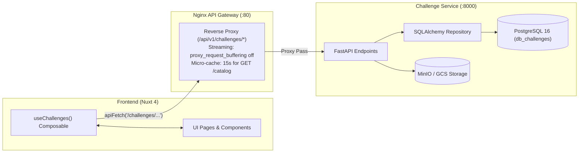

# Conecta Nexus — Challenge API Contract & Frontend Integration Guide

> **Target Audience:** Frontend Engineering Team (Nuxt 4 / Vue 3)  
> **Composables & Types:** `app/composables/useChallenges.ts` & `app/types/challenge.ts`  
> **Backend Service:** [`conecta-nexus/challenge`](https://github.com/conecta-nexus/challenge) (FastAPI + SQLAlchemy Async + PostgreSQL 16)  
> **Gateway Routing:** `http://localhost/api/v1/challenges/` $\rightarrow$ `conecta-challenge:8000`

---

## 1. Executive Architecture Overview

All communication between the Nuxt 4 frontend and the Challenge microservice passes through the central **Nginx API Gateway**. The gateway forwards client authorization headers, applies rate limits, and optimizes large file streaming for attachments up to 10MB (`proxy_request_buffering off;`).



---

## 2. Core Domain Types & Enumerations (`app/types/challenge.ts`)

```typescript
export type DifficultyLevel = 'BEGINNER' | 'INTERMEDIATE' | 'ADVANCED'
export type Modality = 'REMOTE' | 'HYBRID' | 'ON_SITE'
export type ChallengeStatus = 'DRAFT' | 'OPEN' | 'IN_PROGRESS' | 'CLOSED' | 'CANCELLED'
export type InitialChallengeStatus = 'DRAFT' | 'OPEN'

export type AllowedMimeType =
  | 'application/pdf'
  | 'image/png'
  | 'image/jpeg'
  | 'image/webp'

export const MAX_ATTACHMENT_SIZE_BYTES = 10 * 1024 * 1024 // 10MB
```

### 2.1. The `Challenge` Entity

| Property | Type | Description |
| :--- | :--- | :--- |
| `id` | `string` (UUID) | Unique challenge identifier. |
| `company_id` | `string` (UUID) | Identity of publishing enterprise (extracted from token). |
| `title` | `string` | Short title ($\le 255$ chars). |
| `description` | `string` | Full problem statement and challenge description (Markdown / Rich Text). |
| `business_process` | `string` | Target operational area or process ($\le 255$ chars). |
| `status` | `ChallengeStatus` | State lifecycle (`DRAFT`, `OPEN`, `IN_PROGRESS`, `CLOSED`, `CANCELLED`). |
| `difficulty_level` | `DifficultyLevel` | Categorical difficulty (`BEGINNER`, `INTERMEDIATE`, `ADVANCED`). |
| `modality` | `Modality` | Execution modality (`REMOTE`, `HYBRID`, `ON_SITE`). |
| `min_semester` | `number` | Minimum eligible student semester ($6 \le \text{semester} \le 10$). |
| `economic_sector` | `string` | Industry/economic sector ($\le 100$ chars). |
| `required_skills` | `string[]` | Technical/soft skills required. |
| `knowledge_areas` | `string[]` | Academic knowledge areas. |
| `attachments` | `ChallengeAttachment[]?` | Technical attachment metadata list. |
| `created_at` | `string` (ISO 8601) | Creation timestamp. |
| `updated_at` | `string` (ISO 8601) | Last update timestamp. |

---

## 3. API Endpoints Contract

### 3.1. Create Challenge (`HU-06`)
- **Route:** `POST /api/v1/challenges/`
- **Auth:** Required (`Bearer <access_token>`, Role: `COMPANY`, Scope: `challenge:create`)
- **Request Body (`ChallengeCreatePayload`):**
  ```json
  {
    "title": "Optimización de Inventario con Inteligencia Artificial",
    "description": "Desarrollo de un modelo predictivo para la gestión de inventarios...",
    "business_process": "Cadena de Suministro y Logística",
    "difficulty_level": "INTERMEDIATE",
    "modality": "REMOTE",
    "min_semester": 7,
    "economic_sector": "Tecnología y Comercio",
    "required_skills": ["Python", "FastAPI", "SQL"],
    "knowledge_areas": ["Machine Learning", "Ingeniería de Software"],
    "status": "OPEN"
  }
  ```
- **Response:** `201 Created` $\rightarrow$ `Challenge` object.

---

### 3.2. Get Challenge Detail (`HU-06`, `HU-09`)
- **Route:** `GET /api/v1/challenges/:id`
- **Auth:** Optional (Public access masks company direct contact details; company owner sees full portfolio details).
- **Response:** `200 OK` $\rightarrow$ `Challenge` object.

---

### 3.3. Update Challenge (`HU-06`, `HU-08`)
- **Route:** `PATCH /api/v1/challenges/:id`
- **Auth:** Required (Must be the challenge creator company; `403 Forbidden` if ownership mismatch).
- **Restrictions:** Only permitted when `status IN ('DRAFT', 'OPEN')`.
- **Request Body (`ChallengeUpdatePayload`):** Partial fields.
- **Response:** `200 OK` $\rightarrow$ updated `Challenge` object.

---

### 3.4. Voluntary Challenge Closure (`HU-08`)
- **Route:** `POST /api/v1/challenges/:id/close`
- **Auth:** Required (`COMPANY` owner).
- **Request Body:**
  ```json
  {
    "reason": "El cupo de estudiantes ha sido cubierto satisfactoriamente por el equipo seleccionado."
  }
  ```
  *(Minimum 15 characters required).*
- **Response:** `200 OK` $\rightarrow$ updated `Challenge` with `status: 'CLOSED'`.

---

### 3.5. Company Own Portfolio (`HU-08`)
- **Route:** `GET /api/v1/challenges/company/me`
- **Auth:** Required (`COMPANY`).
- **Query Parameters:** `page` (default 1), `limit` (default 10), `status` (optional filter).
- **Response:** `200 OK` $\rightarrow$ `PaginatedResponse<Challenge>`.

---

### 3.6. Opportunity Catalog & Reactive Multi-Criteria Filter (`HU-09`, `HU-10`)
- **Route:** `GET /api/v1/challenges/catalog`
- **Auth:** Public / Anonymous allowed.
- **Gateway Caching:** 15-second micro-cache on public anonymous queries.
- **Query Parameters:**
  - `q`: Search keyword over title and description.
  - `economic_sector`: Filter by sector.
  - `modality`: `REMOTE`, `HYBRID`, or `ON_SITE`.
  - `difficulty_level`: `BEGINNER`, `INTERMEDIATE`, or `ADVANCED`.
  - `skill`: Filter by required skill.
  - `knowledge_area`: Filter by knowledge area.
  - `min_semester`: Maximum student semester barrier.
  - `page`: Page number (default 1).
  - `limit`: Items per page (default 10).
- **Response:** `200 OK` $\rightarrow$ `PaginatedResponse<Challenge>`.

---

### 3.7. Technical Attachment Management (`HU-07`)

1. **Upload Attachment (`POST /api/v1/challenges/:id/attachments`):**
   - **Content-Type:** `multipart/form-data`
   - **Field:** `file`
   - **Constraints:** Maximum 10MB ($10{,}485{,}760$ bytes); formats: PDF, PNG, JPEG, WEBP.
   - **Response:** `201 Created` $\rightarrow$ `ChallengeAttachment`.
2. **Ephemeral Download URL (`GET /api/v1/challenges/:id/attachments/:attachmentId/download`):**
   - **Response:** `200 OK` $\rightarrow$ `{ "download_url": "https://...", "expires_in_seconds": 3600 }`.
3. **Delete Attachment (`DELETE /api/v1/challenges/:id/attachments/:attachmentId`):**
   - **Response:** `204 No Content`.

---

## 4. Nuxt 4 Composable Usage (`useChallenges()`)

The composable `useChallenges()` wraps [`useApi()`](file:///home/anorak/Code/microservices-college/conecta-nexus/frontend/app/composables/useApi.ts) and handles reactive state, automatic token injection, silent token renewal, loading indicators, and error catching.

### 4.1. Creating a Challenge in a Component / Page
```vue
<script setup lang="ts">
import { ref } from 'vue'
import { useChallenges } from '~/composables/useChallenges'
import type { ChallengeCreatePayload } from '~/types/challenge'

const { createChallenge, loading, error } = useChallenges()

const form = ref<ChallengeCreatePayload>({
  title: '',
  description: '',
  business_process: '',
  difficulty_level: 'INTERMEDIATE',
  modality: 'REMOTE',
  min_semester: 6,
  economic_sector: '',
  required_skills: [],
  knowledge_areas: [],
  status: 'OPEN',
})

async function onSubmit() {
  try {
    const created = await createChallenge(form.value)
    navigateTo(`/challenges/${created.id}`)
  } catch (err) {
    console.error('Submission failed:', err)
  }
}
</script>
```

### 4.2. Searching & Filtering the Opportunity Catalog
```vue
<script setup lang="ts">
import { ref, onMounted } from 'vue'
import { useChallenges } from '~/composables/useChallenges'
import type { ChallengeCatalogFilter } from '~/types/challenge'

const { challenges, pagination, loading, fetchCatalog } = useChallenges()

const filters = ref<ChallengeCatalogFilter>({
  q: '',
  modality: undefined,
  difficulty_level: undefined,
  page: 1,
  limit: 12,
})

async function applyFilters() {
  await fetchCatalog(filters.value)
}

onMounted(() => {
  applyFilters()
})
</script>
```

### 4.3. Uploading & Downloading Attachments
```vue
<script setup lang="ts">
import { useChallenges } from '~/composables/useChallenges'

const { uploadAttachment, getAttachmentDownloadUrl, loading } = useChallenges()
const props = defineProps<{ challengeId: string }>()

async function onFileSelected(event: Event) {
  const target = event.target as HTMLInputElement
  const file = target.files?.[0]
  if (!file) return

  if (file.size > 10 * 1024 * 1024) {
    alert('File exceeds 10MB limit')
    return
  }

  await uploadAttachment(props.challengeId, file)
}

async function onDownload(attachmentId: string) {
  const res = await getAttachmentDownloadUrl(props.challengeId, attachmentId)
  window.open(res.download_url, '_blank')
}
</script>
```

---

## 5. Upcoming User-Facing Pages & Ownership

The following tasks will build the user-facing `.vue` pages on top of this composable and type system:

1. **[`FRONTEND-TASK-02`](https://github.com/conecta-nexus/frontend/issues/10)**: `/challenges/new` (Company Challenge Creation Form Page by @NelsonConde).
2. **[`FRONTEND-TASK-05`](https://github.com/conecta-nexus/frontend/issues/13)**: `/challenges/manage` (Company Portfolio & Dashboard Page by @juandiegosb).
3. **[`FRONTEND-TASK-07`](https://github.com/conecta-nexus/frontend/issues/15)**: `/challenges` (Opportunity Catalog Grid & Discovery Cards by @NelsonConde).
4. **[`FRONTEND-TASK-08`](https://github.com/conecta-nexus/frontend/issues/16)**: `/challenges/:id` (Public Challenge Detail Page by @juandiegosb).
